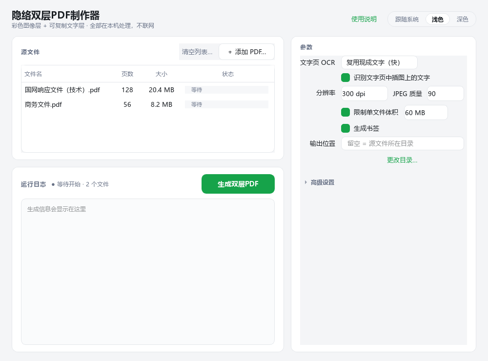
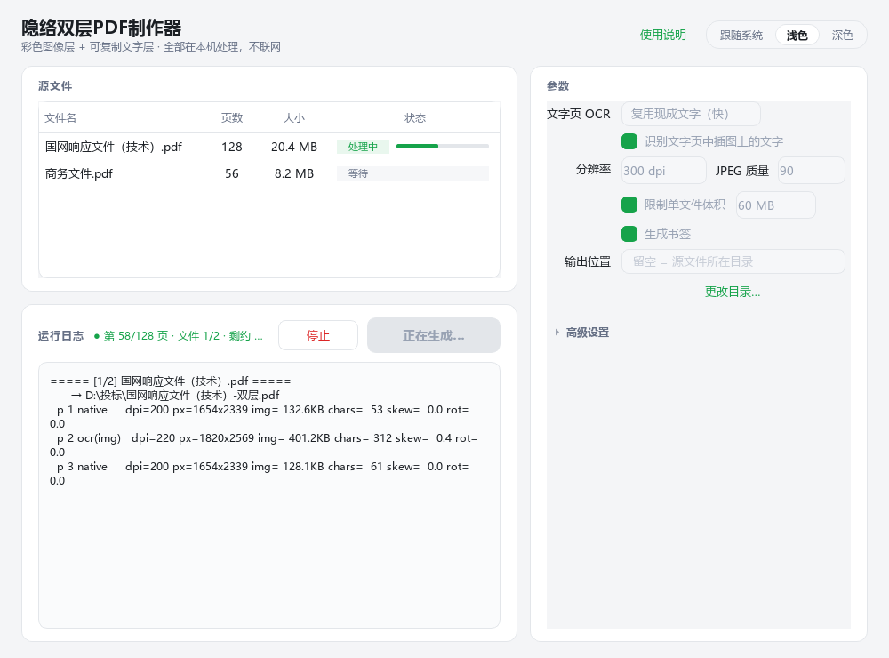
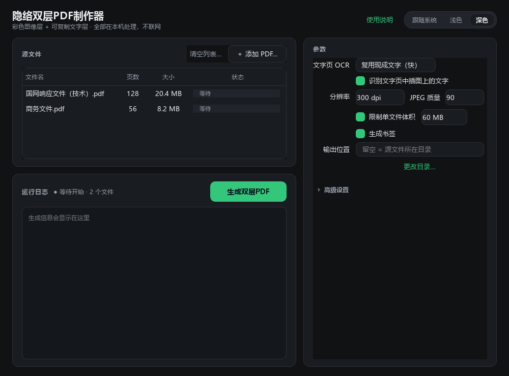

# 隐络双层PDF制作器

把普通 PDF 转换成「双层 PDF」：上层是彩色图像（版式 1:1 保留），下层是可复制、可搜索的隐形文字层。全部在本机离线处理，不联网。



## 功能

- **文字页复用**：本身有文字层的页直接复用原字形坐标，不做 OCR，快且零误差
- **插图区域识别**：文字页里的插图（证书、图纸、截图）会被裁出单独识别，结果并入文字层
- **整页扫描件识别**：没有文字层的扫描页自动整页 OCR，含翻转/倾斜校正
- **整页 OCR 模式**：对已有文字层不放心的文档，可强制逐页识别
- **竖排文字识别**：横排页面里贴的竖排扫描件也能正确识别方向
- **书签生成**：沿用原大纲；没有的从目录页解析生成；目录页是扫描图的会重新高清识别
- **体积控制**：可设单文件体积上限，超限时自动先降 JPEG 质量、再降分辨率
- **页面级缓存**：同样内容不重复识别，改参数重转只算受影响的页
- **批量处理**：多文件队列、逐文件进度、整体 ETA、失败不中断
- **浅色/深色主题**，可跟随系统

## 界面

| 运行中 | 深色 |
|---|---|
|  |  |

## 快速开始

需要 Python 3.10+（Windows）：

```bat
pip install -r requirements.txt
运行.bat
```

也可以直接用命令行转换（无窗口）：

```
python main.py --convert 输入.pdf [输出.pdf] [--dpi 300] [--quality 90] [--threads 3]
```

## 打包 exe

```
pip install pyinstaller
打包.bat
```

产物在 `dist\隐络双层PDF制作器\`，整个文件夹拷走即可分发。

## 目录结构

```
main.py            入口（GUI + --convert 命令行）
dl.py              转换核心：页面分类、OCR、文字层构建、体积控制、缓存
bookmarks.py       书签/大纲生成
app/               PySide6 界面
assets/            图标
tools/             图标生成、预览截图、冒烟测试等开发工具
docs/              界面截图
```

## 技术栈

PySide6（界面）· PyMuPDF（PDF 读写与渲染）· RapidOCR / ONNX Runtime（文字识别）· OpenCV（图像处理）

## 许可

MIT
